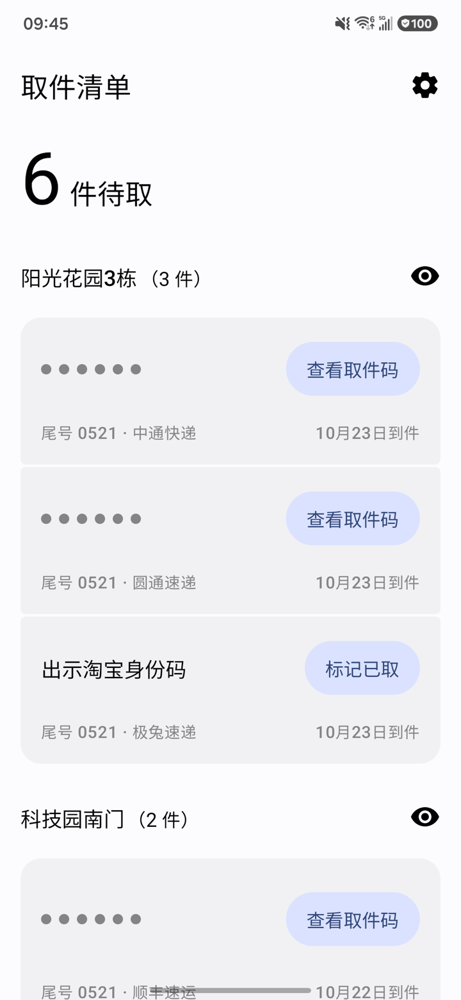
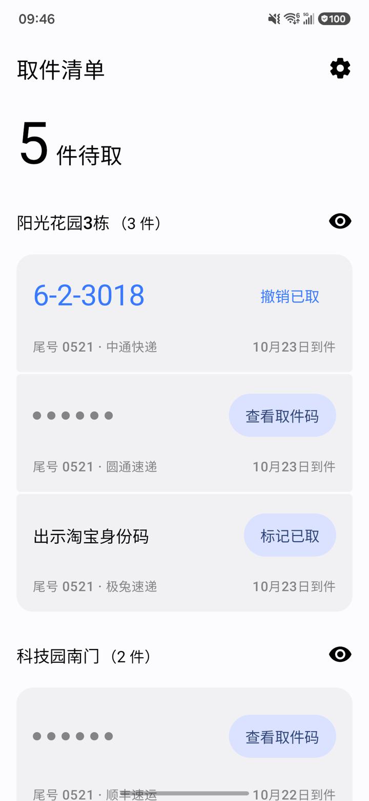
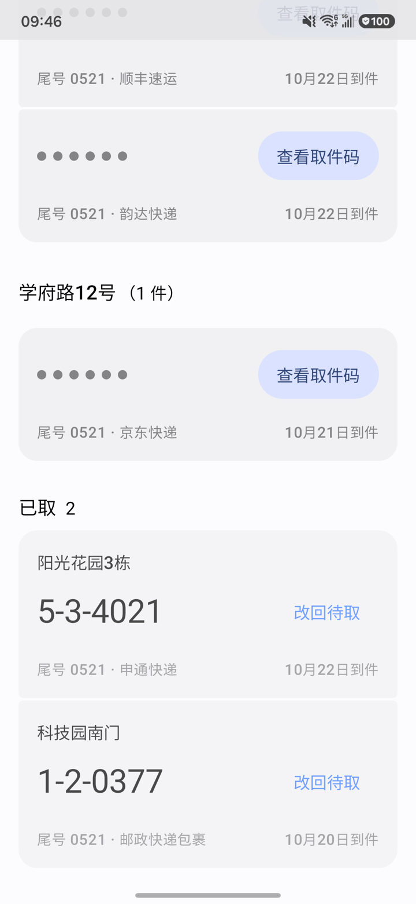

# 取件清单 (Pickup)

简洁现代的 Android 取件码清单应用。自动解析取件短信，提供分组待取清单与取件通知。

## 截图

  
  
  

从左到右：按地点分组的待取清单，取件码先遮住；到了驿站点「查看取件码」，看码即记为已取，可就地撤销；已取区列出最近取走的包裹。截图里是演示数据。

## 特性

- **智能短信解析**：纯本地规则解析菜鸟驿站、丰巢柜、兔喜生活、妈妈驿站、多多驿站等主流取件短信，自动提取货架码、快递柜格口号及快递公司。
- **即时通知与防骚扰**：收到新短信即刻通知新包裹的到达地点与待取概览（通知里不显示取件码），并可通过通知使用权自动撤销默认短信应用的重复提醒。
- **按地点分组**：按取件地点聚合卡片，支持单件揭码与「查看全部取件码」，看码即记为已取。
- **严格离线**：不申请网络权限，短信只在本机解析，数据不出手机。
- **现代 Android 技术栈**：
  - Jetpack Compose + Material 3 Expressive
  - Navigation 3
  - Hilt 依赖注入
  - Room 本地数据库

## 构建环境

- Android SDK 37 (Min SDK 29)
- JDK 21
- Gradle 9.8.2

## 开发

规格在 `specs/`，进度在 `docs/progress.md`；工作约定、环境与架构见 [`AGENTS.md`](AGENTS.md)，所有文档从那里索引。

## 许可证

Copyright (C) 2026 mariohide

本项目以 [GNU 通用公共许可证第 3 版（GPL-3.0）](LICENSE) 发布：可以自由使用、修改和分发，但分发修改版时须以同一许可证公开源码。

测试用的真实短信语料取自 [PickupCodeGrabber](https://github.com/O-kai/Xiaomi-HyperOs-pickup-code-grabber)（MIT License，Copyright (c) 2026 O-kai）。
